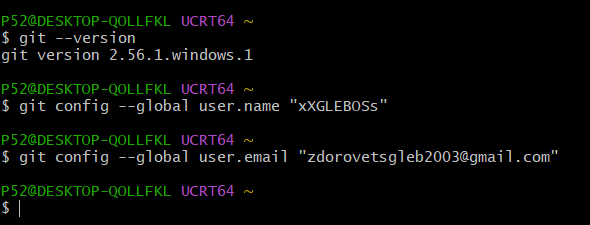
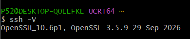
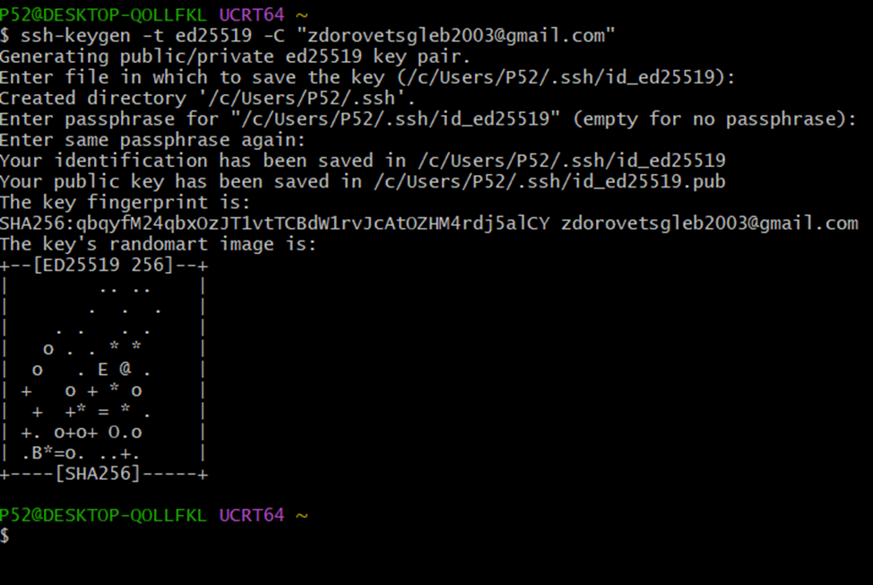
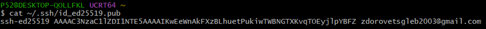
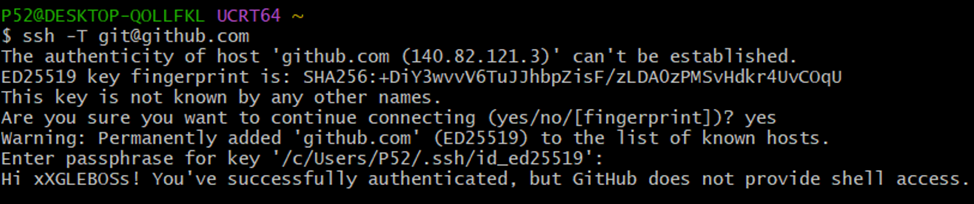
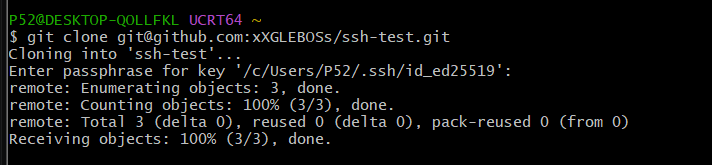
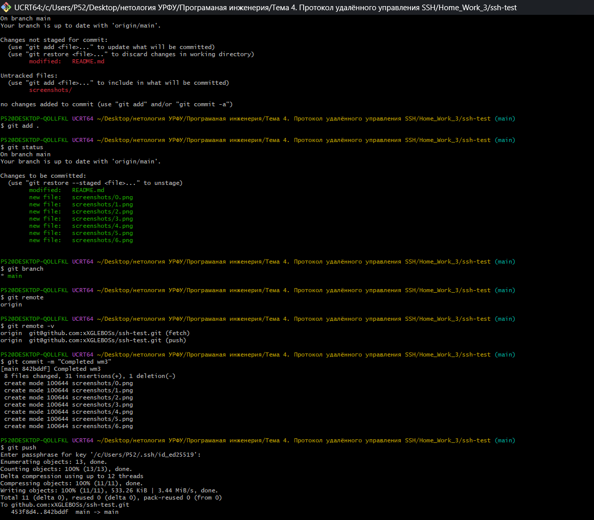
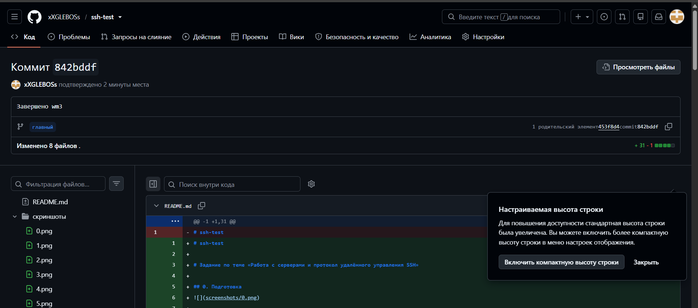

# ssh-test

# Задание по теме «Работа с серверами и протокол удалённого управления SSH»

## 0. Подготовка

- 

## 1. Установка SSH-клиента и генерация ключевой пары

- SSH-клиента присутствует

- сгенерирована новая пара ключей
- приватный ключ защищён паролем 

- публичный ключ сохранён в ~/.ssh/.

## 2. Добавление публичного ключа в аккаунт GitHub

- Ключ успешно добавлен

## 3. Проверка SSH-подключения к GitHub

- соединение устанавливается без пароля и возвращается приветствие от GitHub.

## 4. Работа с репозиторием по SSH

- Репозиторий скопирован

- коммит создан, git push выполенен с введением пароля безопасноти ключа

- коммит отображается